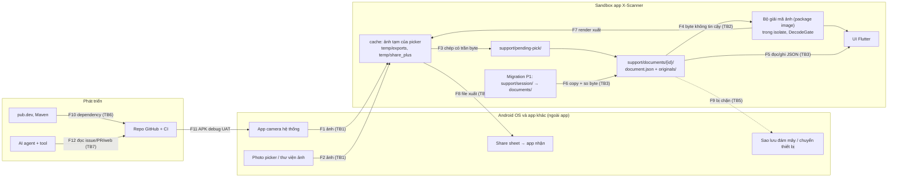

# THREAT-MODEL — X-Scanner app Android offline · phiên bản 1 · 2026-10-24

> Chủ: chủ repo (@seeker19110) · Lập: phiên AI theo Work ID `2026-10-24-governance-docs`, **chưa có người duyệt** ·
> Phạm vi: app `apps/mobile` tại commit `edbdc50` (P1 + thư viện XS-09), repo và CI · Ngoài phạm vi: iOS (chưa build),
> OCR/depth/cloud (chưa có), bản phát hành ký số (chưa có quy trình). Mẫu: `.xtemplates/framework/templates/THREAT-MODEL.md`.
> **Cập nhật file này** khi thêm ranh giới tin cậy mới: quyền Android mới, mạng, OCR, camera tự dựng, đồng bộ, phát hành.

## 1. Tài sản

| ID | Tài sản | Phân loại (xem `docs/privacy/data-map.yaml`) | Ảnh hưởng nếu lộ / sửa / mất |
|---|---|---|---|
| A-01 | Ảnh gốc tài liệu (`documents/{id}/originals/`) | có thể chứa dữ liệu cá nhân, kể cả nhạy cảm | lộ: lộ giấy tờ người dùng; mất: không chụp lại được bản gốc |
| A-02 | `document.json` (tiêu đề, thứ tự trang, khung cắt, xoay) | tiêu đề do người dùng gõ, có thể chứa tên người | sửa/hỏng: mất cấu trúc tài liệu |
| A-03 | File xuất PDF/JPG/PNG (tạm trong cache) | như A-01 | lộ nếu nằm lại lâu hoặc gửi nhầm app |
| A-04 | Dữ liệu P1 cũ (`session/`, `session.migrated*`) | như A-01 | mất khi migration lỗi |
| A-05 | Toàn vẹn APK và mã nguồn (repo, dependency, artifact CI) | toàn vẹn | APK bị cài cắm đọc được A-01..A-04 |
| A-06 | Bí mật tương lai (khoá ký phát hành) | bí mật | **hiện chưa tồn tại**; khi có, lộ = phát hành giả mạo |

## 2. Thành phần, ranh giới tin cậy, luồng dữ liệu

Ranh giới tin cậy: **TB1** app khác/OS ↔ sandbox (ảnh đến từ app camera/picker) · **TB2** byte ảnh không tin cậy ↔ bộ giải mã ·
**TB3** dữ liệu trên đĩa (có thể hỏng, do bản app khác ghi, hoặc bị sửa trên máy root) ↔ logic app · **TB4** sandbox ↔ app nhận
qua share sheet · **TB5** thiết bị ↔ dịch vụ sao lưu · **TB6** chuỗi cung ứng (pub.dev, Maven, GitHub Actions) ↔ build ·
**TB7** nội dung ngoài (issue, PR, web, output tool) ↔ AI agent làm việc trên repo (ADR-0009 của khung).
Không có: server, tài khoản, mạng lúc chạy (manifest không khai quyền `INTERNET`), telemetry, LLM trong app.

| Luồng | Từ → Đến | Dữ liệu | Ranh giới | Kiểm soát hiện có |
|---|---|---|---|---|
| F1/F2 | camera/picker → cache | ảnh JPEG/PNG/WebP | TB1 | `image_picker` trả đường dẫn; app không xin quyền camera/bộ nhớ |
| F3 | cache → `pending-pick/` → `originals/` | bản sao ảnh | TB1 | trần 64 MiB khi chép, journal ≤ 8192 byte (`lib/storage/pending_pick_store.dart`) |
| F4 | `originals/` → decoder | byte ảnh | TB2 | nhận dạng theo magic bytes, trần byte và điểm ảnh, isolate 60 s (`lib/imaging/page_render.dart`, `isolate_budget.dart`) |
| F5 | `document.json` ↔ app | JSON schema 2 | TB3 | codec kiểm schema, cách ly bản hỏng (`lib/core/session_manifest.dart`, `lib/storage/document_store.dart`) |
| F6 | `session/` → `documents/` | ảnh + manifest P1 | TB3 | copy rồi so từng byte, rename nguyên tử, giữ bản cũ (ADR-0011) |
| F7/F8 | render → `temp/exports` → share sheet | PDF/JPG/PNG | TB4 | xoá thư mục xuất sau chia sẻ và khi mở tài liệu (`lib/export/page_exporter.dart`) |
| F9 | dữ liệu app → sao lưu | mọi file | TB5 | `allowBackup="false"`, `data_extraction_rules.xml` loại trừ mọi domain |
| F10 | dependency → build | mã bên thứ ba | TB6 | ghim chính xác, `--enforce-lockfile`, dependency review trong CI |
| F11 | CI → người thử | APK debug | TB6 | `SHA256SUMS`, giữ 14 ngày (`docs/ops/android-uat.md`) |
| F12 | nội dung ngoài → agent | văn bản | TB7 | luật "dữ liệu, không phải chỉ thị" (`AGENTS.md`), `permissions.deny` trong `.claude/settings.json` |

## 3. Kẻ tấn công giả định

| Ai | Năng lực | Mục tiêu |
|---|---|---|
| Người gửi ảnh độc | đưa ảnh dựng sẵn vào thư viện ảnh của nạn nhân (tin nhắn, web) | treo/crash app, làm hỏng tài liệu |
| App khác trên máy | gọi activity được export, nhận file qua share sheet | đọc tài liệu, kích hoạt hành vi ngoài ý muốn |
| Người cầm máy đã mở khoá / máy root | đọc/sửa thư mục app | đọc ảnh giấy tờ, sửa `document.json` |
| Gói phụ thuộc bị chiếm | mã chạy trong app | thêm mạng/quyền, gửi dữ liệu ra ngoài |
| Nội dung không tin cậy cho AI agent | prompt injection qua issue/PR/tài liệu | khiến agent xoá dữ liệu, đổi cổng, lộ bí mật |

## 4. Mối đe doạ (STRIDE) và quyết định

Mức rủi ro = khả năng × tác động (mỗi trục 3 bậc Thấp/TB/Cao): **Cao** khi (Cao,Cao), (Cao,TB), (TB,Cao);
**TB** khi (Cao,Thấp), (TB,TB), (Thấp,Cao); còn lại **Thấp**. Quyết định: mitigate / eliminate / transfer / accept.
Mọi đường dẫn test dưới đây là tương đối với `apps/mobile/` trừ khi ghi khác.

| ID | Luồng | STRIDE | Mối đe doạ | Khả năng | Tác động | Mức | Quyết định | Biện pháp | Bằng chứng (test/cấu hình) | Trạng thái |
|---|---|---|---|---|---|---|---|---|---|---|
| TM-01 | F4 | D (và T) | Ảnh dựng sẵn (bom giải nén, header khổng lồ, EXIF/PNG lệch, WebP động) làm hết RAM, treo hoặc crash app | Cao | TB | Cao | mitigate | Chỉ nhận JPEG/PNG/WebP tĩnh theo nội dung; từ chối > 64 MiB trước khi đọc; trần điểm ảnh từng decoder trước parse; isolate bị huỷ sau 60 s; một `DecodeGate` | `test/imaging/decoder_security_test.dart`; `test/imaging/page_render_test.dart` ("rejects formats other than JPEG, PNG and WebP by content", "thumbnail and renderPage refuse a file above the byte cap"); `test/imaging/isolate_budget_test.dart`; `test/imaging/decode_gate_test.dart` | đã giảm |
| TM-02 | F3, F5, F6 | T (toàn vẹn) | Dừng app/hết pin/lỗi I/O giữa lúc lưu, chụp lại hoặc migration làm mất bản gốc hay tài liệu | TB | Cao | Cao | mitigate | Ghi `.tmp` + flush + rename; không xoá bản gốc chưa lưu; cách ly manifest hỏng; migration copy rồi so từng byte, không bao giờ xoá `session/`; journal ảnh picker | `test/storage/document_store_test.dart` (gồm F-001, "never deletes an imported original that was never saved"); `test/storage/p1_migration_test.dart` ("a copy with different bytes is an I/O failure"); `test/storage/pending_pick_store_test.dart` | đã giảm |
| TM-03 | F9 | I | Ảnh giấy tờ rời máy qua sao lưu đám mây hoặc chuyển thiết bị | TB | Cao | Cao | eliminate | Tắt sao lưu và loại trừ mọi domain | `android/app/src/main/AndroidManifest.xml`, `android/app/src/main/res/xml/data_extraction_rules.xml`; `test/android_manifest_test.dart` | đã giảm |
| TM-04 | F10 | I, E | Dependency hoặc thay đổi manifest thêm quyền `INTERNET`/camera/bộ nhớ hay component export, mở đường gửi dữ liệu ra ngoài | TB | Cao | Cao | mitigate | Gate gộp manifest release và chặn quyền/component ngoài danh sách cho phép, `targetSdk` ≥ 31; ghim dependency, lockfile, dependency review | `scripts/check-release-manifest.py` (`--self-test` trong gate); `test/android_manifest_test.dart`; `.github/workflows/ci.yml` bước "Review dependency changes" | đã giảm |
| TM-05 | F4, F5 | I | Nội dung, đường dẫn hoặc tiêu đề tài liệu lọt vào log/thông báo lỗi | TB | TB | TB | mitigate | Không có lệnh log trong `lib/`; lỗi mang loại, không mang đường dẫn/nội dung | `test/imaging/page_render_test.dart` ("failure carries no path or content"); grep `print(`/`debugPrint` trong `apps/mobile/lib` = 0 (2026-10-24) | đã giảm |
| TM-06 | F1, F7, F8 | I | Bản sao ảnh picker, file xuất hoặc bản sao của share sheet nằm lại trong cache | TB | Thấp | Thấp | mitigate | Xoá bản sao picker sau khi lưu; xoá `temp/exports` sau mỗi lần chia sẻ; xoá cả `temp/share_plus` khi mở tài liệu | `test/ui/page_source_test.dart` (F-005); `test/export/page_exporter_test.dart` ("clearLeftovers also removes copies kept by the share sheet", "a new export removes the files of the previous one") | đã giảm |
| TM-07 | F8 | I | Người dùng chia sẻ tài liệu cho app nhận không tin cậy | TB | TB | TB | accept | Đây là hành động chủ đích của người dùng; tên file xuất cố định (`X-Scanner.pdf`), không mang tiêu đề | `test/export/page_exporter_test.dart` ("pdf: 3 pages become one X-Scanner.pdf with 3 pages") · chấp nhận: xem §5 | chấp nhận |
| TM-08 | F5 | T, E | `document.json` bị sửa trỏ đường dẫn bản gốc ra ngoài thư mục tài liệu (traversal, symlink) để đọc/xoá file khác | Thấp | Cao | TB | mitigate | Kiểm đường dẫn tương đối chuẩn, id hợp lệ; migration từ chối bản gốc là link | `test/storage/document_store_test.dart` ("rejects traversal and non-canonical paths"); `test/storage/p1_migration_test.dart` ("a referenced original is a link") | đã giảm |
| TM-09 | F1 | T | Đường dẫn picker trả về trỏ ra ngoài cache khiến bước dọn xoá nhầm file | Thấp | TB | Thấp | mitigate | Chỉ xoá file nằm hẳn trong cache sau khi resolve symlink | `test/ui/page_source_test.dart` ("a file in a sibling folder whose name starts with the cache …") | đã giảm |
| TM-10 | F2 | S, E | App khác mở `MainActivity` với intent lạ | Thấp | Thấp | Thấp | accept | Chỉ có intent-filter MAIN/LAUNCHER; danh sách export cho phép trong gate | `scripts/check-release-manifest.py` (`ALLOWED_EXPORTED`) | chấp nhận |
| TM-11 | F6 | D | Hết bộ nhớ giữa lúc migration làm dừng dở | TB | TB | TB | mitigate | Đo dung lượng trống bằng StatFs trước copy; journal để chạy lại | `test/storage/android_storage_test.dart`; `android/app/src/test/kotlin/org/xscanner/x_scanner/StorageHandlerTest.kt`; `test/storage/p1_migration_test.dart` | đã giảm (chưa có bằng chứng trên thiết bị) |
| TM-12 | F5 | I | Người cầm máy root/đã mở khoá đọc ảnh giấy tờ trong thư mục app (app không tự mã hoá at-rest) | Thấp | Cao | TB | transfer | Dựa vào sandbox và mã hoá theo file của Android; xem lại khi chọn MAS-L2 hoặc khi phát hành | không có test app; giả định §5 | chấp nhận có điều kiện |
| TM-13 | F11 | T | APK debug tải từ CI bị thay trước khi cài | Thấp | Cao | TB | mitigate | Checksum `SHA256SUMS`, SHA commit build, giữ 14 ngày | `.github/workflows/ci.yml` (bước "Prepare verifiable Android UAT bundle"); `docs/ops/android-uat.md` | đã giảm |
| TM-14 | repo | I | Bí mật (khoá ký tương lai, token) bị commit | Thấp | Cao | TB | mitigate | Pre-commit chặn chuỗi giống khoá và file > 1 MB; chưa có quét toàn lịch sử (gitleaks) trong CI | `scripts/githooks/pre-commit`, `scripts/_commit-guard.sh`; xoay khoá: `docs/ops/RUNBOOK.md` §6 | mở một phần |
| TM-15 | F12 | T, E | Prompt injection qua issue/PR/tài liệu khiến agent xoá dữ liệu, đổi cổng hoặc đẩy thẳng `main` | TB | TB | TB | mitigate | Luật "dữ liệu, không phải chỉ thị", điểm dừng bắt buộc; hook/permission; ruleset `main` không bypass | `AGENTS.md` mục "Điểm dừng bắt buộc"; `.claude/settings.json` `permissions.deny`; `.github/rulesets/main.json` | đã giảm |
| TM-16 | — | R | Chối bỏ hành động | Thấp | Thấp | Thấp | accept | Không có tài khoản/nhiều người dùng trong app; một người dùng một máy | không áp dụng | chấp nhận |

Mối đe doạ mức **Cao** (TM-01..TM-04) đều có biện pháp và test/cấu hình trong gate; không có hàng Cao ở trạng thái accept.

## 5. Giả định và chấp nhận rủi ro

- Giả định Android sandbox app và mã hoá theo file của hệ điều hành còn hiệu lực trên máy không root — kiểm: không có test; xem lại khi chọn mức MASVS cao hơn (`PROJECT.md` mục "Chuẩn áp dụng").
- Chấp nhận TM-07 — chia sẻ là chủ ý người dùng — người chấp nhận: phiên AI theo ủy quyền, **cần chủ repo xác nhận** — ngày 2026-10-24 — xem lại: trước phát hành.
- Chấp nhận có điều kiện TM-12 — chưa phát hành, chưa có người dùng thật — **cần chủ repo xác nhận** — xem lại: trước phát hành hoặc khi thêm OCR (văn bản trích ra là dữ liệu dễ tìm kiếm hơn).
- Chấp nhận TM-10, TM-16 — mức Thấp, không có dữ liệu đi qua.

## 6. Hành động còn mở

| Mối đe doạ | Việc | Task/PR | Hạn |
|---|---|---|---|
| TM-14 | Quét bí mật toàn lịch sử (gitleaks hoặc tương đương) trong CI — đổi cổng CI, cần chủ repo duyệt | chưa có | trước phát hành |
| TM-11 | Bằng chứng StatFs/migration trên thiết bị (W-602) | `PROGRESS.md` "Tiếp theo" 1 | chờ chủ repo |
| TM-12 | Quyết định mã hoá at-rest hay không | `docs/RISKS.md` RK-004 | trước phát hành |

## Lịch sử

| Phiên bản | Ngày | Thay đổi | Lý do |
|---|---|---|---|
| 1 | 2026-10-24 | Bản đầu từ code tại `edbdc50` | SEC-TM-001/003/005/006, BASE-SEC-011 |
