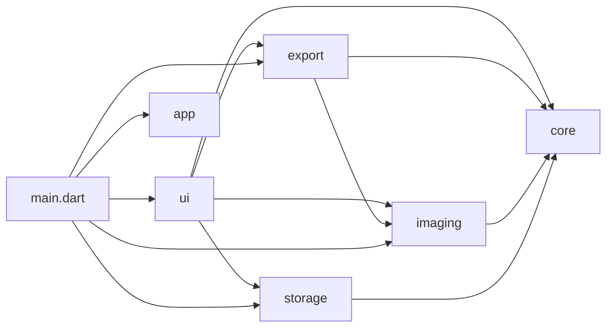

# Miền và module của app X-Scanner

> ARC-MOD-008. Lập 2026-10-24 từ `CODEMAP.md` và import thật trong `apps/mobile/lib` tại commit `edbdc50`
> (lệnh kiểm ở cuối file). Đổi thư mục cấp một hoặc hướng phụ thuộc → cập nhật file này và `CODEMAP.md` trong cùng PR.

## Miền nghiệp vụ (bounded context)

| Miền | Ngôn ngữ chung | Spec chính |
|---|---|---|
| Tài liệu và trang | tài liệu, trang, khung 4 góc (`PageQuad`), xoay, `revision`, thư viện | P0, XS-08 (hợp đồng revision), XS-09 |
| Lưu trữ bền | bản gốc, `document.json`, cách ly, migration, ảnh chờ (pending pick) | P1 FR-2, XS-09, picker preservation |
| Xử lý ảnh | giải mã, EXIF, nắn phối cảnh (homography), thumbnail, ngân sách giải mã | P1 FR-5, XS-07a/b, W-104b |
| Xuất và chia sẻ | tác vụ xuất, PDF/JPG/PNG, tiến độ, huỷ, share sheet | P1 FR-6/7, XS-12a |
| Trải nghiệm (UI) | màn thư viện, màn tài liệu, trình chỉnh góc, thông báo, theme | P1, XS-13, scanner experience |

## Thư mục cấp một của `apps/mobile/lib` ↔ miền

| Thư mục | Miền | Phụ thuộc được phép (import thật) | Package ngoài | Ghi chú |
|---|---|---|---|---|
| `core/` | Tài liệu và trang | không module nào | không (Dart thuần) | Không import Flutter; kiểm bởi `apps/mobile/test/core/core_purity_test.dart` |
| `storage/` | Lưu trữ bền | `core` | `package:flutter` chỉ ở leaf `android_storage.dart` (platform channel) | |
| `imaging/` | Xử lý ảnh | `core` | `image` | |
| `export/` | Xuất và chia sẻ | `core`, `imaging` | `pdf`, `share_plus`, Flutter | |
| `ui/` | Trải nghiệm | `core`, `export`, `imaging`, `storage` | Flutter, `image_picker` | |
| `app/` | Trải nghiệm (theme) | không | Flutter | Chỉ `theme.dart` |
| `main.dart` | gốc ghép nối | mọi module | `path_provider` | Nối thư mục lưu, cổng giải mã, exporter |

Hướng phụ thuộc (`A --> B` nghĩa là A import B):



Luật: `core` không phụ thuộc gì; không module nào phụ thuộc ngược lên `ui`; `storage` và `imaging` không phụ thuộc nhau.

## Độ lệch so với yêu cầu "chia theo miền"

Thư mục cấp một hiện đặt theo **tầng kỹ thuật** nhưng mỗi thư mục trùng đúng một miền ở bảng trên (riêng "Trải nghiệm" gồm
`ui/` và `app/`). Không đổi cấu trúc code trong lần lập tài liệu này: đổi tên/di chuyển thư mục là thay đổi mã, cần chủ repo duyệt.
Xem lại khi: thêm miền mới (OCR, depth, đồng bộ) hoặc một thư mục bắt đầu chứa hai miền.
Chưa có script CI so khớp `lib/*` với bảng này (đổi CI cần chủ repo duyệt); kiểm tay bằng lệnh dưới.

## Lệnh kiểm

```bash
cd apps/mobile/lib && ls -d */
for d in app core export imaging storage ui; do
  echo "$d -> $(grep -rhoE "^import '(\.\./)+[a-z_]+/" $d | sed -E "s#import '(\.\./)+##; s#/##" | sort -u | grep -v "^$d$" | tr '\n' ' ')"
done
```

Kết quả 2026-10-24: `app ->` (rỗng), `core ->` (rỗng), `export -> core imaging`, `imaging -> core`, `storage -> core`,
`ui -> core export imaging storage`.
